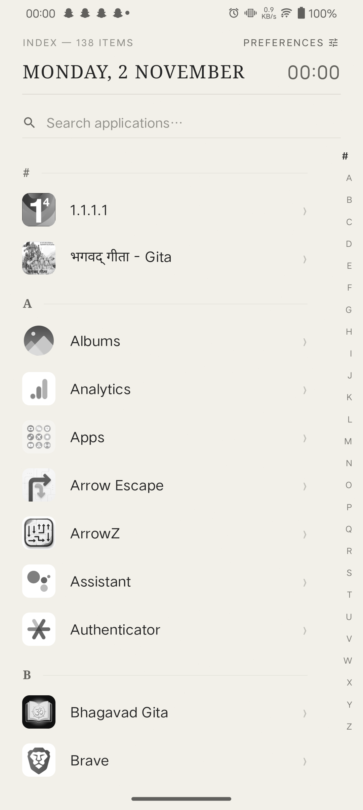
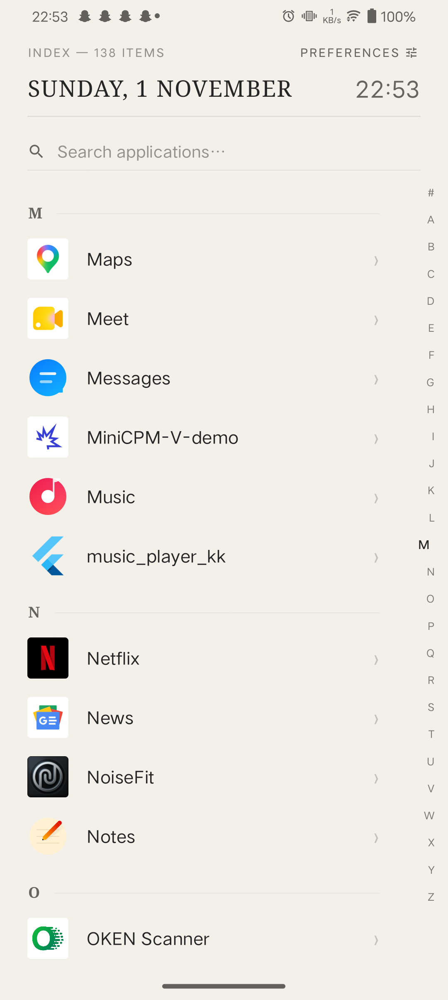
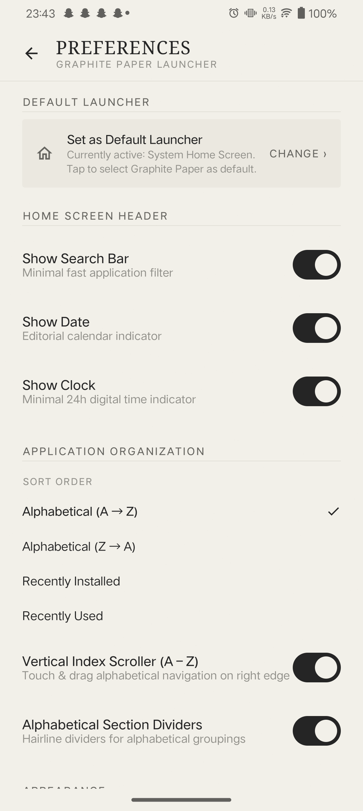
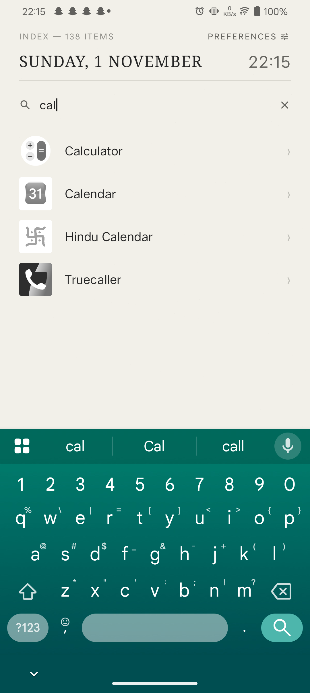
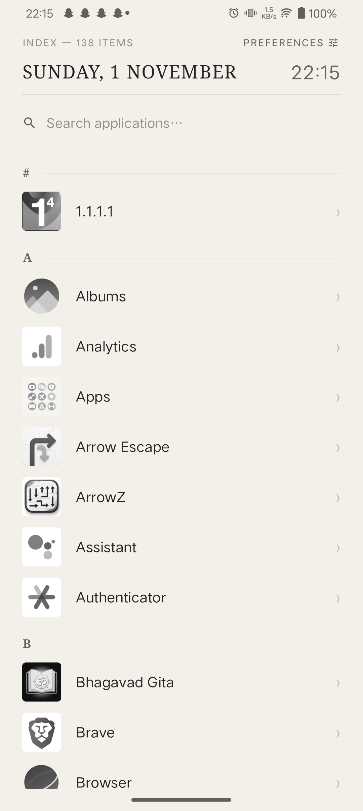

# NOIR Launcher

> **Less interface. More intention.**

An exceptionally restrained, editorial Android home launcher inspired by Swiss typography, tactile paper textures, and graphite aesthetics. Built entirely with modern native Android technologies: Kotlin, Jetpack Compose, Material 3, and DataStore Preferences.

[](https://github.com/kachakaran6/noir/releases/tag/v0.1.0)
[-65645F?style=flat-square)](https://developer.android.com)
[](https://kotlinlang.org)
[](https://developer.android.com/jetpack/compose)
[](https://github.com/kachakaran6/noir/releases/tag/v0.1.0)

---

## Visual Gallery

Real device captures from the v0.1.0 production release running on Android 13:

| Home Screen (Paper) | Curved Alphabet Navigator | Default Launcher Settings |
|:---:|:---:|:---:|
|  |  |  |

| Instant Search Filter | Long-Press Context Menu |
|:---:|:---:|
|  |  |

---

## Design Philosophy

Conventional Android launchers overwhelm your attention with colorful gradients, floating app widgets, badge notifications, and gamified dock counters. **NOIR** strips away the noise:

- **Warm Natural Paper Surface (`#F2F0E9`)**: High-legibility editorial backdrop with procedural micro-grain fibers rendered dynamically at 120 FPS.
- **Graphite Charcoal Aesthetics (`#252525`)**: High-contrast typography combining serif headlines (`EditorialSerif`) and crisp sans-serif indices (`SwissSans`).
- **Mathematical Arc Scrubbing**: Right-edge A–Z index dynamically deflects toward the thumb using a Gaussian curve distribution with active letter magnification and tactile feedback.
- **Intentional Application List**: Single-column vertical index sorted your way, keeping interactions calm and direct.

---

## Features

### 1. Default Android Launcher Integration
- Registered as an official Android `HOME` and `DEFAULT` application in `AndroidManifest.xml`.
- Integrated with Android 10+ `RoleManager.ROLE_HOME` and system `ACTION_HOME_SETTINGS` fallback.
- In-app status detection verifying real-time default home app assignment.
- Robust task affinity and `singleTask` launch mode ensuring pressing Home brings you directly to NOIR without activity recreation.

### 2. Curved Alphabet Navigation Instrument
- Touch-driven vertical scrubbing tracking pointer input at 120 FPS.
- Dynamic Gaussian curve deflection:
  $$\text{deflection}(d) = -18 \cdot \exp\left(-\frac{d^2}{2\sigma^2}\right)\,\text{dp}$$
- Floating Letter Preview badge with tactile tick (`HapticFeedbackType.TextHandleMove`) on section crossing.
- Instant list synchronization while dragging, smooth settling animation on release.

### 3. Application Organization & Fast Search
- Real-time case-insensitive search by application name or package name.
- Optional search bar toggle in Preferences.
- 4 Sorting strategies:
  1. **Alphabetical (A $\rightarrow$ Z)**
  2. **Alphabetical (Z $\rightarrow$ A)**
  3. **Recently Installed**
  4. **Recently Used** (integrated with Android `UsageStatsManager`)
- Dynamic package listener updating the catalog when apps are installed, replaced, or removed.

### 4. Advanced Icon Customization
- **5 Container Geometries**: Original, Circle, Rounded Square, Square, Squircle.
- **3 Color Modes**:
  - *Original Colors*: Preserves native application artwork.
  - *Theme Matched*: Monochromatic graphite/charcoal tones matching active paper mode.
  - *Custom Tint*: Curated editorial palette (Graphite, Charcoal, Slate, Stone, Warm Grey, Pure White) or custom ARGB color.
- **Size Slider**: Scalable from 24dp to 56dp with live real-time preview.

### 5. Privacy & Hidden Applications
- Long-press any app to inspect app info, uninstall, or hide.
- Dedicated hidden applications vault with one-tap restore.

---

## Installation

### Option A: Download GitHub Release APK (Recommended)
1. Navigate to [NOIR Releases](https://github.com/kachakaran6/noir/releases/tag/v0.1.0).
2. Download `app-release.apk`.
3. Open the APK on your Android device and confirm installation (allow installation from unknown sources if prompted).
4. Launch **NOIR** and tap the "SET AS DEFAULT LAUNCHER" banner or navigate to **Preferences $\rightarrow$ Set as Default Launcher**.

### Option B: Build from Source
```bash
git clone https://github.com/kachakaran6/noir.git
cd noir
./gradlew assembleRelease
```
The signed APK will be generated at `app/build/outputs/apk/release/app-release.apk`.

---

## Setting NOIR as Default Launcher

1. Launch **NOIR**.
2. Tap **PREFERENCES** at the top right of the home screen.
3. Under the **DEFAULT LAUNCHER** section, tap **Set as Default Launcher / CHANGE ›**.
4. When Android's "Select Home app" prompt appears, choose **NOIR Launcher** and select **Always**.
5. Press the physical Home button or perform the system home swipe gesture to confirm instant return.

---

## Pros & Cons

### Verified Advantages
- **Distraction-Free**: Zero algorithmic feeds, notification dots, or ad trackers.
- **Ultra-Lightweight**: Zero third-party analytics SDKs; 100% offline-first.
- **Hardware Accelerated**: Fluid Compose rendering with sub-16ms frame times on physical devices.
- **Persisted Preferences**: Reliable Jetpack DataStore engine preserving all user choices across device reboots.

### Real Constraints & Limitations
- **Third-Party AppWidget Hosting**: Standard minimalist list design hosts native editorial date/clock metrics; third-party `AppWidgetHost` containers are intentionally omitted to maintain clean editorial hierarchy.
- **OEM Gesture Insets**: On custom OEM skins (e.g., Funtouch OS, ColorOS), edge-swipe back navigation occupies the outer 10–12dp of the screen bezel; NOIR insets the alphabet scrubber to prevent gesture conflicts.

---

## Tech Stack

- **Language**: Kotlin 2.0.21
- **UI Toolkit**: Jetpack Compose (BOM 2024.10.01) with Material 3
- **Architecture**: Single Activity, MVVM with Kotlin Coroutines & StateFlow
- **Storage**: Jetpack DataStore Preferences
- **System Integration**: Android `RoleManager`, `PackageManager`, `UsageStatsManager`, `BroadcastReceiver`
- **Build System**: Android Gradle Plugin 8.7.2, Java 17

---

## Release Verification (v0.1.0)

- **Application ID / Package**: `com.samyukt.noir`
- **Application Name**: `Noir`
- **Release Artifact**: `release/app-release.apk`
- **SHA-256 Checksum**: `386C884FD572B85551AA189D2C5B5DED0685585BDE424E1943A457E4D9937370`
- **Signature Scheme**: APK Signature Scheme v2 (Verified via Android SDK `apksigner`)
- **Target OS**: Android 8.0 (API 26) through Android 15 (API 35)

---

## Troubleshooting

### Cannot set NOIR as default launcher
Open Android system **Settings $\rightarrow$ Apps $\rightarrow$ Default apps $\rightarrow$ Home app**, and select **NOIR Launcher**.

### "Recently Used" sort order shows alphabetical order
Android requires explicit user authorization to share application usage timestamps. In **Preferences $\rightarrow$ Sort Order**, tap the **Usage Access Required** banner to grant permission in Android Settings.

---

## Credits & License

Engineered with precision for minimalist enthusiasts. All rights reserved.

